# Smart Studio UI (3.5" 480x320)

LVGL v8.4 touch UI reference for the ESP32 course Session 08 midterm,
"Smart Studio UI": ESP32-S3, 3.5-inch 480 x 320 ST7796 SPI LCD in RGB565,
FT6336 capacitive touch, and the PC Web Serial companion in
[docs/web_serial_starter.html](docs/web_serial_starter.html).

Zero-text high-contrast dark UI (`#050608`): four swipeable pages (Light with a
16-ray 360-degree radiant sun dial and tap/drag core, Air conditioner,
Temperature, Humidity), a circular Scenes panel (Home, Sleep, Away) and a
Connection baud-stepper panel.

## UI Preview

### Main Screens & Overlays

| Light (80 %) | Air conditioner (24 °C) | Temperature (27 °C) |
|---|---|---|
| 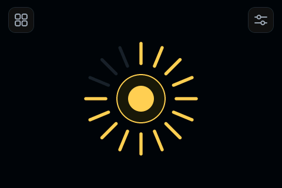 | 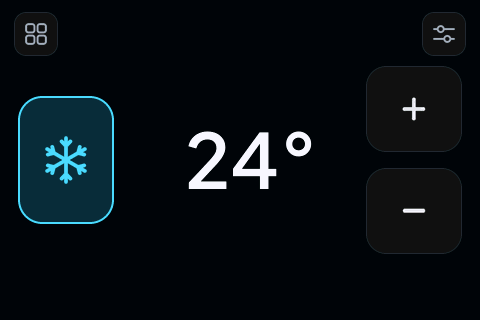 | 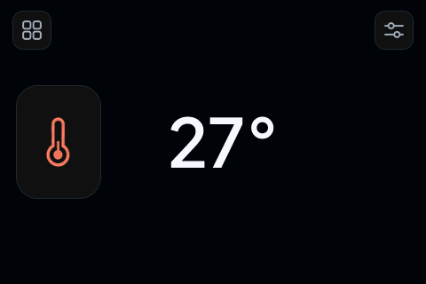 |

| Humidity (58 %) | Scenes (Home) | Connection (115200) |
|---|---|---|
| 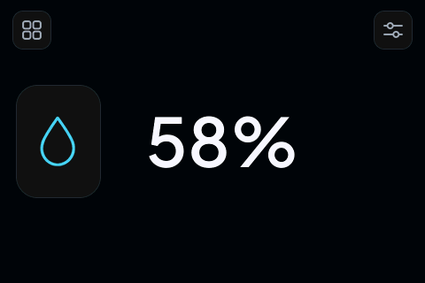 | 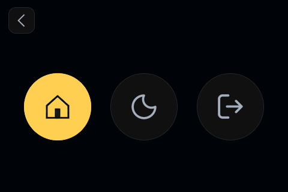 | 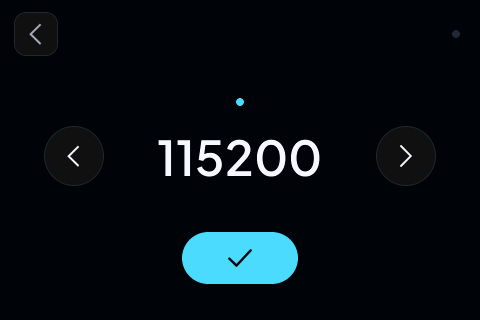 |

<details>
<summary>Additional states (dimmed, off, unavailable, pending/failed baud)</summary>

| Light dimmed (27 %) | Light off | AC off (30 °C) |
|---|---|---|
| 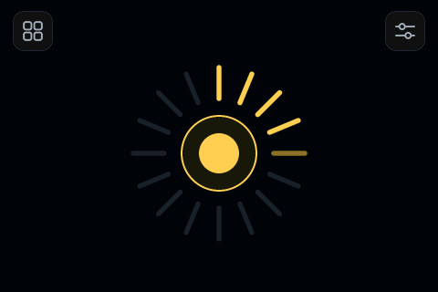 | 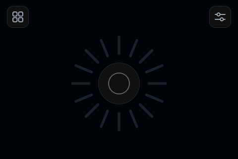 | 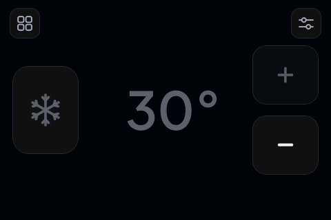 |

| Sensor unavailable (`—`) | Baud pending (230400) | Baud failed (230400) |
|---|---|---|
| 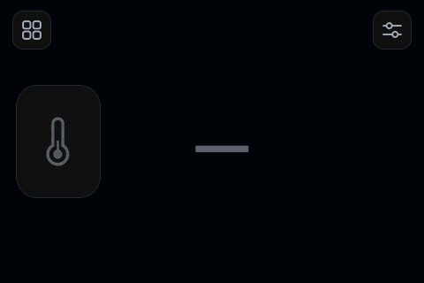 | 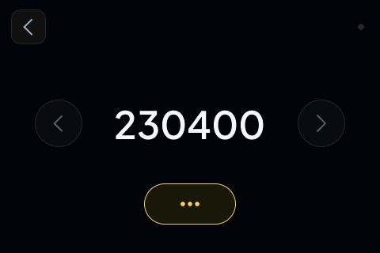 | 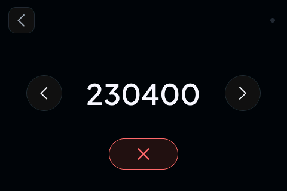 |

</details>

All 19 scenario captures (`480 x 320`) live in [docs/screenshots/](docs/screenshots/).

## Quick start (Windows Simulator)

```powershell
tools/build_sim.bat
tools/run_regression.bat
sim_pc\build\sim_pc.exe
```

The simulator opens at the panel's physical size (`73.44 x 48.96 mm`). If it does
not measure 73 mm wide on your monitor, press `+` or `-` until it does; the
calibration is saved per monitor resolution. Press `V` to switch between real
size, pixel `1:1`, and pixel `2:1` views. Keys `1`–`4` jump pages, `H`/`S`/`A`
simulate PC scenes, `E` toggles room data availability, and `F` forces the next
baud request to fail. Other options and headless flags are in
[sim_pc/README.md](sim_pc/README.md).

The first build needs network access to fetch LVGL v8.4.0; later builds reuse
the cached source in `sim_pc/build/_deps`.

## Repository layout

| Path | Contents |
|---|---|
| `ui.c`, `ui.h`, `ui_*.c/.h`, `studio_comm.h` | Portable LVGL v8.4 UI module, exported to the firmware |
| `sim_pc/` | Native Windows GDI simulator, regression suite (8,986 checks), strict-C99 smoke check, `lv_conf.h` |
| `tools/` | Build, regression, MCU export, icon/font generator, and `.raw` to `.png` scripts ([tools/README.md](tools/README.md)) |
| `assets/icons/studio/` | 31 canonical icon masters (`4x` supersampled masks) and `manifest.json` |
| `docs/` | [Midterm assignment](docs/MIDTERM_ASSIGNMENT.md), [Web Serial starter](docs/web_serial_starter.html), [design brief](docs/UI_DESIGN_BRIEF.md), [firmware guide](docs/FIRMWARE_INTEGRATION.md), [screenshots](docs/screenshots/) |

## MCU Firmware Integration & Export

```powershell
tools/export_mcu.bat --verify
tools/export_mcu.bat D:\path\to\firmware
```

See [docs/FIRMWARE_INTEGRATION.md](docs/FIRMWARE_INTEGRATION.md) for the
`lv_conf.h` settings (48 KiB heap, single 480 x 20 partial draw buffer,
`LV_COLOR_16_SWAP`), the four GUI-context calls (`ui_init`, `ui_apply`,
`ui_note_rx`, `ui_baud_complete`), UART-to-GUI queuing, and runtime baud
switching. The wire JSON field mapping is in [studio_comm.h](studio_comm.h).
