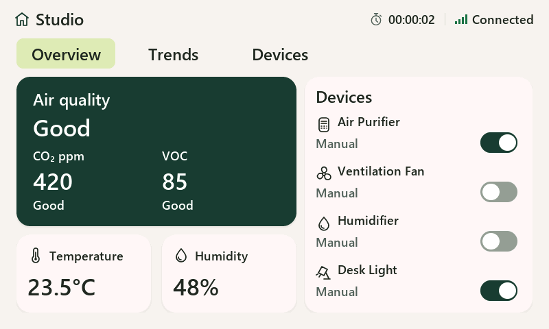
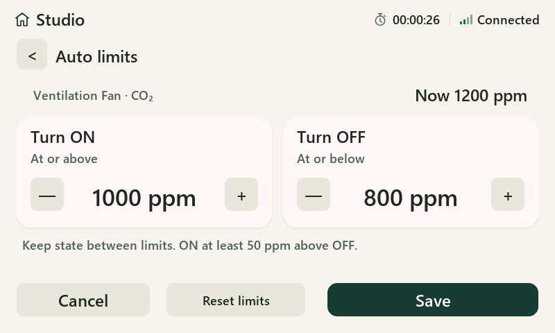

# Quiet Architecture — native implementation and self-review

**Visual acceptance superseded:** the owner rejected implementation fidelity.
See the [2026-09-18 review](../2026-09-18-design-fidelity/REVIEW.md). This report
and its captures remain historical implementation evidence; passing functional
checks does not establish resemblance to the accepted concepts.

Date: 2026-09-17. Scope: owner's accepted design, information reduction,
18px minimum typography, then actual LVGL implementation. This is an implementation
self-review, not an independent hardware certification.

## Result

Implemented Overview, Trends, Devices, Settings and Auto limits in LVGL8.4.
System decisions are recorded in [UI_DESIGN_BRIEF](../../UI_DESIGN_BRIEF.md).
Removed duplicate headings, decorative reassurance, small-card explanatory
captions, redundant ON/OFF text and obsolete badge/ppm-position code. Preserved
sensor units, metric warning attribution, mode, pending/error feedback and Retry.

Settings/Auto uses the full area below the persistent header. It no longer
retains the Devices object tree underneath: the original attempt exceeded the
42KiB heap budget. Releasing/rebuilding page widgets solved this without changing
the model, radio contract or Auto engine. No full-screen MCU framebuffer added.

The ui-ux-pro-max skill informed readable hierarchy, touch spacing, inline errors,
disabled-state clarity and contrast. Its generic16px default was overridden by
the owner's18px floor. Mobile-only features such as OS Dynamic Type, screen-reader
integration and portrait layouts were not imported into the fixed embedded HMI.

## Native captures

These are real800x480 RGB565 simulator renders, not AI concept images.

- [Overview](home_good.png), [Moderate](home_moderate.png), [Poor](home_poor.png).
- [Trends](trends_data.png), [empty history](trends_empty.png).
- [Devices](devices_grid.png), [Settings](devices_settings.png).
- [CO2 Auto](devices_auto_thresholds.png), [VOC Auto](devices_auto_purifier.png),
  [humidity Auto](devices_auto_humidifier.png), [maximum CO2](devices_auto_max_10000.png).
- [Invalid draft](devices_auto_invalid_draft.png),
  [Manual-only type](devices_settings_manual_only.png).
- [Dropdown](dropdown_open_top.png), [scrolled dropdown](dropdown_open_bottom.png).
- [Offline](home_offline.png), [sensor failure](home_sensor_fail.png),
  [temperature/humidity unavailable](home_temp_humid_invalid.png),
  [pending output](home_relay_pending.png), [Retry](home_relay_retry.png),
  [Auto error](home_auto_paused.png), [Auto sensor pause](home_auto_paused_switch.png).
- [Degraded link](home_link_degraded.png), [unchanged splash](splash.png).





## Verification

Commands run from repository root:

```powershell
tools/build_sim.bat
tools/run_regression.bat
tools/export_mcu.bat --verify
tools/verify_production.bat
```

- Simulator Release build: PASS. Cached LVGL8.4.0, no dependency update.
- Full wrapper: smoke, regression, single capture, scenario generator PASS.
- Final direct regression: **32/32**, [complete output](REGRESSION.txt).
- Geometry/pointer assertions updated to the new layout, not simply removed.
- New check32 audits visible label/dropdown fonts across all pages, eight preset
  settings, all three supported Auto editors, dropdowns and invalid drafts.
  A deliberate default-font negative double proves that audit detects a font
  below the floor. The expected diagnostic is not a failing result.
- It also verifies conservative aggregate quality, full signed temperature
  display bounds, pointer entry to Settings, page-tree release, live sensor
  invalidation/recovery, range-disabled steppers, invalid-parent indication and
  disabled unsupported Auto. Long temperature values may use24px, never below18px.
- Existing Auto/LoRa regression remains intact: 3 fresh frames, 10s hold,
  polarity, reported-vs-desired state, timeout/late report, reconnect, sensor
  recovery, explicit re-arm, draft Save/Cancel, no-op callback and tick rollover.
- 50 complete interaction cycles: minimum settled free memory **9032 bytes**,
  minimum largest free block **7576 bytes**, measured stable drift **0 bytes**.
  Separate page sampling includes Overview at8512 bytes free. These are sampled
  host metrics, not proof of the physical MCU's total firmware memory map.
- Ten identical Home frames: **0 flushes /0 pixels**. Ten changed CO2 frames:
  9 flushes /55536 pixels; idle full-second:4230 pixels for the uptime header.
- 24 scenario frames generated and converted via `tools/raw2png.py`. Key nominal,
  error, bounds and dropdown screens visually inspected at native size.
- MCU export manifest: PASS. Production verification: exported artifact checks,
  isolated C99 Release build with `-Wall -Wextra -Werror`, smoke without test hooks,
  and deliberate negative control (exit1 with expected error) PASS.
- `git diff --check`: PASS. Existing CMake CMP0177 developer warning is nonfatal.

## Text contrast

Computed from the palette after RGB565 quantization/bit-replication, using
relative sRGB luminance. This measures digital colors, not panel optics.

| Pair | Ratio |
|---|---:|
| Ink / porcelain |14.31:1|
| Secondary / porcelain |6.19:1|
| Secondary / canvas |5.91:1|
| White / forest |12.14:1|
| Ink / celadon |11.98:1|
| Error text / porcelain |6.80:1|
| Ink / disabled control |5.45:1|

Disabled Save changes its label to dark ink so it remains readable. Dropdown
selected/pressed states explicitly override the default LVGL blue. Editor step
buttons are48x48; other interactive targets retain at least44px height.

## Limits and handoff

- Actual LCD viewing distance, backlight, viewing angle, touch accuracy, target
  memory/linker map and QSPI dirty-region timing have not been tested here.
- Flat fills and existing font/icon assets intentionally replace raster-concept
  gradients. The warm/forest hierarchy is preserved without rasterizing the UI.
- Browser study12 is retained as historical, not synchronized to this redesign.
- Pre-existing dirty-worktree changes were preserved. No commit, push, packet
  schema change, firmware radio driver or Flash driver was introduced.
- The separate existing CURRENT verification-tooling handoff was not rewritten
  or declared completed by this UI implementation. No new UI fix prompt is needed
  for a known unresolved defect from this self-review.

Run `sim_pc/build/sim_pc.exe` for interactive review; next acceptance step is
checking these screens on the actual LCD.
