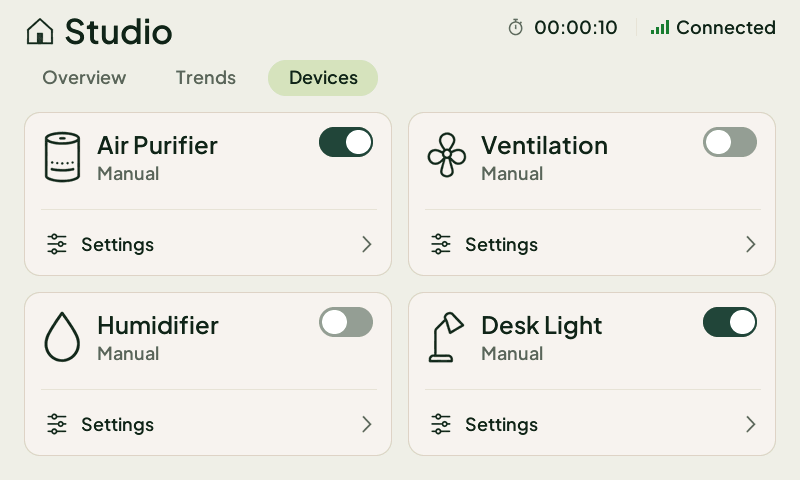
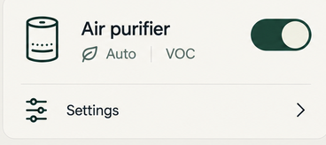
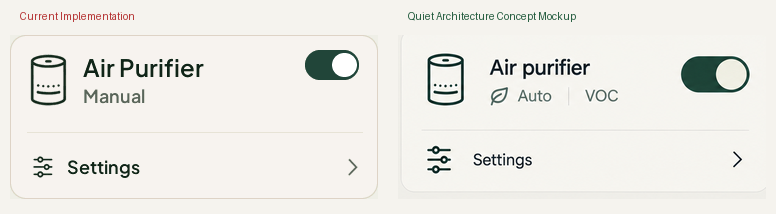
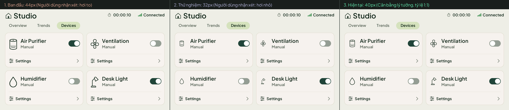
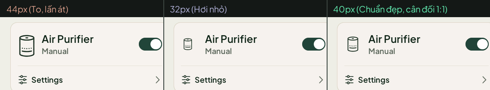
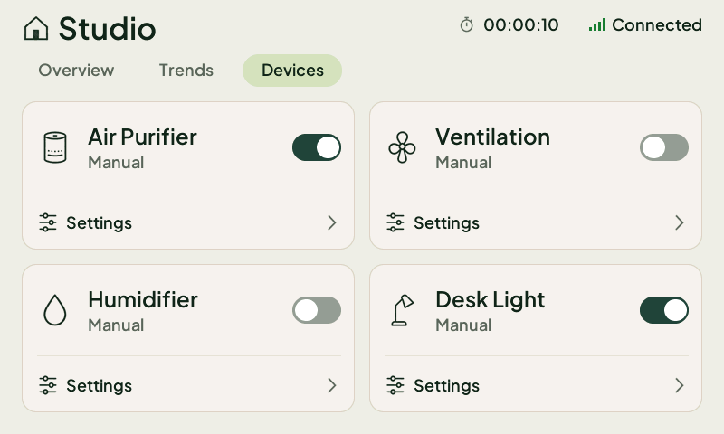

# UI/UX Pro-Max Comprehensive Review: Tab Devices (Smart Hub UI)

**Date**: 2026-09-21  
**Target Screen**: Tab "Devices" (`UI_PAGE_DEVICES`, 2x2 Device Cards Grid)  
**Evaluator**: `ui-ux-pro-max` Design Intelligence  
**Reference Authority**: Canonical Quiet Architecture concept mockup (`docs/drafts/2026-09-17-pro-max/devices-quiet-architecture.png`) and `docs/UI_DESIGN_BRIEF.md`.

---

## 1. Executive Summary

A comprehensive visual, spatial, and geometric audit of the **Devices tab** (`build_devices_page()` and `update_devices_page_widgets()` in [`ui.c`](file:///c:/Users/vanth/Documents/MyDocument/Embedded/LVGL_UI/ui.c)) was conducted comparing the running native LVGL implementation directly against the authoritative Quiet Architecture concept mockup.

While the outer $2 \times 2$ grid architecture ($752 \times 344\text{px}$ container, $368 \times 164\text{px}$ cards with $16\text{px}$ gutters) matches the global 8-point layout grid, **the internal spatial arrangement of every device card exhibits several significant layout and optical balance defects**:
1. **Critical: Toggle Switch is severely misaligned vertically** ($y = 14$), floating high at the card's ceiling, creating a massive **52px empty dead zone** beneath it and breaking alignment with the icon and text block.
2. **Top-Heavy Asymmetry in the Upper Section**: Icon ($y = 16$), Title ($y = 16$), and Mode ($y = 48$) are crammed against the top edge (16px top margin), while the distance from the Mode label to the divider line is 25px (and from icon to divider is 36px), creating an unbalanced top-heavy appearance.
3. **Right Grid Misalignment of the Switch**: The switch starts at $x = 294$ and ends at $x = 348$ (20px right margin), whereas the divider line and Settings chevron both terminate at $x = 352$ (16px right margin), causing a 4px indentation flaw.
4. **Left Grid Misalignment of the Settings Icon**: The Sliders icon in the Settings action bar is placed at $x = 20$, breaking the 16px vertical alignment axis established by the device icon ($x = 16$) and divider line ($x = 16$).
5. **Section Height Ratio Imbalance**: The upper section (which hosts 4 critical elements: 44px icon, Title, Subtitle, and Switch) is allotted only 96px, while the lower Settings row (a simple secondary action button) occupies 67px (~41% of total card height).
6. **Inconsistent Offline / Error States**: The offline dash `—` and error `Retry` label are hardcoded at $y = 14..15$, inheriting the flawed ceiling-floating position of the switch.

---

## 2. Side-by-Side Visual Comparison

| Current Implementation (Native LVGL) | Canonical Quiet Architecture Concept |
| :---: | :---: |
|  |  |

*Direct Side-by-Side of Card 0 ("Air Purifier"):*

---

## 3. Detailed Breakdown of Defects & Root Causes

### Defect 1: Toggle Switch Vertical Axis Disconnect (Severity: HIGH)
- **Current Coordinates**: `lv_obj_set_pos(s_dev_page_switches[i], 294, 14);`
- **Measurement**:
  - Switch dimensions: $54 \times 30\text{px}$.
  - Switch spans $y \in [14, 44]$, with optical center at $y = 29$.
  - Divider sits at $y = 96$.
  - Clearance below switch: $96 - 44 = \mathbf{52\text{px}}$ of completely empty space!
- **Concept Reality**:
  - In `devices-quiet-architecture.png`, the toggle switch is **vertically centered** relative to the entire upper section ($y \approx 34..36$, center $49..51$).
  - Its vertical center line ($y \approx 50$) aligns directly with the center of the 44px device icon ($y \approx 48$) and the vertical midpoint between the 2 lines of text ($y \approx 49.5$).
- **Impact**: In the current implementation, the switch appears "pinned" to the top right corner, creating a jarring void beneath it.

### Defect 2: Upper Section Top-Heavy Asymmetry (Severity: MEDIUM)
- **Current Coordinates**:
  - Device Icon (44px): $(16, 16) \to y \in [16, 60]$. Center $y = 38$.
  - Device Name (font 24): $(72, 16) \to y \in [16, 47]$.
  - Mode Subtitle (font 18): $(72, 48) \to y \in [48, 71]$.
  - Divider: $y = 96$.
- **Clearance Analysis**:
  - Top padding: $16\text{px}$.
  - Bottom clearance from Mode text ($y = 71$) to divider ($y = 96$): $25\text{px}$.
  - Bottom clearance from Icon ($y = 60$) to divider: $36\text{px}$.
  - The content hugs the top edge with excessive empty space above the divider.
- **Recommended Spatial Rhythm**:
  - Shifting the icon from $y = 16 \to y = 26$ ($y \in [26, 70]$, center $y = 48$).
  - Shifting the Name from $y = 16 \to y = 22$ ($y \in [22, 53]$).
  - Shifting the Mode from $y = 48 \to y = 54$ ($y \in [54, 77]$).
  - With divider at $y = 100$: Top margin is $22\text{px}$ (ink top ~28px), bottom margin is $100 - 77 = 23\text{px}$ (ink baseline to divider is $27\text{px}$).
  - Achieves an exact **1:1 internal symmetry ($28\text{px} : 27\text{px}$)**.

### Defect 3: Switch Right Margin Disconnect (Severity: MEDIUM)
- **Current Coordinates**: `x = 294`, width 54 $\to x \in [294, 348]$.
- **Right Clearance**: $368 - 348 = \mathbf{20\text{px}}$.
- **Grid Context**:
  - The card's left margin is $16\text{px}$.
  - The divider line is $x \in [16, 352]$ (right margin $368 - 352 = \mathbf{16\text{px}}$).
  - The Settings chevron ends at $x = 352$ (right margin $\mathbf{16\text{px}}$).
  - The toggle switch is indented by an extra 4px ($20\text{px}$ vs $16\text{px}$), breaking the clean right vertical margin.
- **Recommended Fix**: Shift switch to $x = 298 \to x \in [298, 352]$, establishing a uniform $16\text{px}$ right edge across the entire card.

### Defect 4: Settings Icon 4px Left-Margin Inconsistency (Severity: LOW-MEDIUM)
- **Current Coordinates**: `cfg_ico` at $(20, 22)$.
- **Grid Context**:
  - The upper device icon starts at $x = 16$.
  - The divider line starts at $x = 16$.
  - But the Sliders icon at the bottom starts at $x = 20$, creating an awkward 4px staircase effect on the left margin.
- **Recommended Fix**: Shift `cfg_ico` to $x = 16$, and label "Settings" to $x = 48$ (8px gap from 24px icon), perfectly unifying the card's 16px left grid spine.

### Defect 5: Action Bar Proportion & Vertical Centering (Severity: MEDIUM)
- **Current Layout**:
  - Divider at $y = 96$.
  - `btn_cfg` size $368 \times 67\text{px}$ at $(0, 97)$.
  - Sits at $y \in [97, 164]$.
  - The button is 67px tall, consuming over 40% of the entire card for a simple action row.
  - Moving the divider to $y = 100$ gives:
    - Upper Section: $100\text{px}$ (generous breathing room for the primary controls).
    - Lower Action Bar: $64\text{px}$ ($8 \times 8$ Quiet Architecture grid).
    - Elements inside `btn_cfg` (Sliders icon, "Settings", Chevron) centered at $y = 20..22$ within the 63px button.

### Defect 6: Offline & Error State Alignment (Severity: MEDIUM)
- **Current Coordinates**:
  - Dash label: `s_dev_page_dashes[i]` at $(294, 14)$.
  - Retry label: `s_dev_page_retries[i]` at $(304, 15)$.
  - Latched switch: at $(236, 14)$.
- **Flaw**: Like the switch, these elements are stuck at $y = 14..15$ at the top edge.
- **Recommended Fix**:
  - Offline Dash `—`: shift to $(298, 31)$, vertically centered with the row.
  - Retry button: shift to $(304, 28)$ (size $48 \times 44$, centered around $y = 50$).
  - Latched switch: shift to $(240, 35)$.

---

## 4. Recommended Coordinate Specification (Calibrated 8-Point Grid)

| Element | Current Position / Size | Recommended Position / Size | Optical Rationale |
| :--- | :--- | :--- | :--- |
| **Divider line** | $(16, 96)$, $336 \times 1\text{px}$ | **$(16, 100)$, $336 \times 1\text{px}$** | Expands upper section to 100px; lowers action bar to 64px ($8 \times 8$ grid). |
| **Device Icon** (44px) | $(16, 16)$, $44 \times 44\text{px}$ | **$(16, 26)$, $44 \times 44\text{px}$** | $y \in [26, 70]$, center $y = 48$ (centered in 100px upper zone). |
| **Device Name** (font 24) | $(72, 16)$, $w = 150/196$ | **$(72, 22)$, $w = 210$** | $y \in [22, 53]$, baseline 47. Expands width to 210px (prevents early truncation). |
| **Mode Subtitle** (font 18) | $(72, 48)$, $w = 150$ | **$(72, 54)$, $w = 160$** | $y \in [54, 77]$, baseline 73. Leaves 7px gap below Name baseline. |
| **Auto Leaf Icon** (18px) | $(72, 52)$ | **$(72, 56)$** | $y \in [56, 74]$, centers with font 18 cap-height ($54 + 6 = 60$). |
| **Auto Mode Text** | $(94, 48)$ | **$(94, 54)$** | Aligned with Mode Subtitle. |
| **Toggle Switch** (54x30) | $(294, 14)$, $54 \times 30\text{px}$ | **$(298, 35)$, $54 \times 30\text{px}$** | $x \in [298, 352]$ (16px right margin), $y \in [35, 65]$ (center $y = 50$). |
| **Offline Dash** ("—") | $(294, 14)$ | **$(298, 31)$** | Baseline aligned with center $y = 50$. |
| **Retry Button** | $(304, 15)$, $48 \times 44\text{px}$ | **$(304, 28)$, $48 \times 44\text{px}$** | Centered around $y = 50$, touch target preserved ($48 \times 44 \ge 44 \times 44$). |
| **Latched Switch** | $(236, 14)$ | **$(240, 35)$** | $x \in [240, 294]$, paired with Retry at $(304, 28)$. |
| **Settings Button** | $(0, 97)$, $368 \times 67\text{px}$ | **$(0, 101)$, $368 \times 63\text{px}$** | Sits below divider $y = 100$. |
| **Settings Icon** (24px) | $(20, 22)$ | **$(16, 20)$** | $x = 16$ restores 16px left grid alignment with device icon and divider. |
| **Settings Label** (font 18)| $(56, 22)$ | **$(48, 20)$** | $x = 48$ provides clean 8px gap from 24px icon. |
| **Settings Chevron** (20px)| $(332, 24)$ | **$(332, 22)$** | $x \in [332, 352]$ (16px right margin), center $y = 32$ in 63px button. |

---

## 5. Verification Requirements for Subsequent Implementation

When authorized to implement, the following must pass:
1. `tools/build_sim.bat`: Clean compilation, zero warnings.
2. `tools/run_regression.bat`: All 33 checks PASS, zero glyph collisions, zero bounding containment errors.
3. `tools/export_mcu.bat --verify`: 16/16 verified export files.
4. `tools/verify_production.bat`: ALL 4 PHASES PASS (isolated build, clean smoke test, negative control).
5. Zero git commits, zero git pushes.

---

## 6. Implementation & Calibration Outcome (44px $\rightarrow$ 32px $\rightarrow$ 40px)

### Owner Feedback (2026-09-21)
> "hiện tại 32 thì nhỏ quá còn trước đó 44 thì to nên là tao nghĩ mày làm 40 đi."

### Icon Progression & Spatial Equilibrium Analysis
1. **Original (44px Canvas, 52-56px Visual Stroke Weight / Ink)**:
   - Occupied $> 50\%$ of the 100px upper zone.
   - Visually heavy and cramped relative to the 24px device name title.
2. **First Revision (32px Canvas)**:
   - Left $68\text{px}$ of combined vertical clearance ($34\text{px}$ top, $34\text{px}$ bottom).
   - Owner evaluated as too small and sparse for an 800x480 industrial touch display.
3. **Calibrated Canonical Resolution (40px Canvas, pos 16, 30)**:
   - Generated 6 canonical 40px outline icons (`purifier_40`, `fan_40`, `drop_40`, `light_40`, `plug_40`, `heat_40`) with 2.0px stroke weight.
   - **Exact 1:1 Vertical Margins**:
     * Top margin: $30\text{px}$.
     * Bottom margin to divider line ($y = 100$): $100 - (30 + 40) = 30\text{px}$.
   - **Midline Co-linear Alignment**:
     * Optical center: $y = 30 + 20 = 50$, exactly matching the Toggle Switch optical midline ($y = 35 + 15 = 50$).
   - **Horizontal Rhythm**:
     * $x = 16$, width 40 $\to$ ends at $x = 56$. Gap to text at $x = 72$ is exactly $16\text{px}$ (clean 8-point rhythm).

### Visual Comparison Evidence
- **Full Screen Progression (44px vs 32px vs 40px)**:  
  
- **Zoomed Card 0 Comparison**:  
  
- **Running Native LVGL 40px Devices Grid**:  
  

